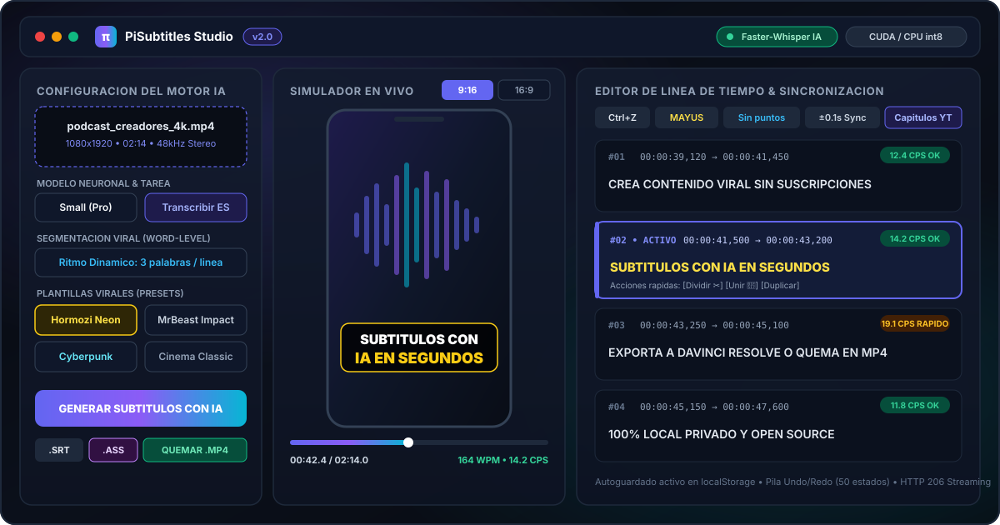
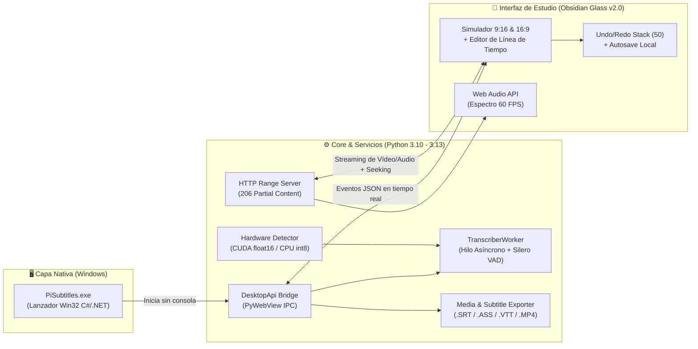

<div align="center">


# ⚡ πSubtitles Studio v2.0

### **Estudio de Escritorio con IA para Subtitulado Automático, Sincronización Word-Level, Plantillas Virales (9:16 / 16:9) y Quemado Directo en Vídeo**

[](https://www.python.org/)
[-6366F1?style=for-the-badge&logo=openai&logoColor=white)](https://github.com/SYSTRAN/faster-whisper)
[](https://ffmpeg.org/)
[](#)
[%20%7C%20Linux%20%7C%20macOS-06B6D4?style=for-the-badge&logo=windows&logoColor=white)](https://github.com/Thepimen/PiSubtitles/releases)
[](LICENSE)

<p align="center">
  <b>100% Local • Sin Suscripciones Cloud • Privacidad Total • Aceleración GPU CUDA &amp; CPU <code>int8</code></b><br/>
  Genera, edita, previsualiza en formato <b>9:16 (TikTok / Reels / Shorts)</b> o <b>16:9 (YouTube)</b> y exporta subtítulos profesionales (<code>.SRT</code>, <code>.ASS</code>, <code>.VTT</code>, <code>.TXT</code>, <code>.JSON</code>) o incrustados directamente en <code>.MP4</code>.
</p>

<p align="center">
  <a href="https://github.com/Thepimen/PiSubtitles/releases/latest"><b>⬇️ Descargar Release Oficial (v2.0.0)</b></a> •
  <a href="#-características-principales"><b>✨ Características</b></a> •
  <a href="#️-arquitectura-del-sistema"><b>🏗️ Arquitectura</b></a> •
  <a href="#-instalación-y-ejecución-rápida"><b>🚀 Inicio Rápido</b></a> •
  <a href="#️-atajos-de-teclado"><b>⌨️ Atajos</b></a>
</p>

<br/>



</div>

---

## 🎯 ¿Por qué πSubtitles Studio?

La mayoría de herramientas de subtitulado para creadores de contenido imponen suscripciones mensuales, límites de minutos, marcas de agua o exigen subir archivos pesados a servidores de terceros.

**πSubtitles Studio v2.0** nace como una solución **nativa, gratuita, Open Source y 100% local**:

- 🔒 **Privacidad y Soberanía de Datos:** Todo el procesamiento neuronal de voz a texto ocurre en tu máquina mediante **Faster-Whisper (`CTranslate2`)** sin enviar un solo byte a la nube.
- ⚡ **Inferencia Ultrarrápida con Hardware Adaptativo:** Detecta automáticamente GPUs **NVIDIA CUDA (`float16`)** con bibliotecas cuBLAS/cuDNN y aplica *fallback* inteligente a **CPU multinúcleo con cuantización `int8`**, logrando transcripciones hasta **4x más rápidas** que la implementación original de OpenAI Whisper consumiendo menos de la mitad de VRAM/RAM.
- 🎬 **Flujo de Trabajo de Estudio Completo:** No solo transcribe; incluye un **simulador visual interactivo 9:16 / 16:9**, analizador de frecuencias en tiempo real (**Web Audio API a 60 FPS**), control de velocidad de lectura (**semáforo CPS y WPM**), plantillas de estilo viral y **quemado directo a `.MP4`** con FFmpeg.

---

## ✨ Características Principales

| Categoría | Funcionalidad | Detalle Técnico |
| :--- | :--- | :--- |
| 🧠 **Motor IA & Voz** | **Word-Level Timestamping + VAD** | Alineación milimétrica palabra por palabra con filtro de actividad de voz **Silero VAD** para ignorar silencios y ruidos de fondo. |
| 🌍 **Multilingüe & Traducción** | **+99 Idiomas y Traducción Directa** | Transcripción en idioma original o traducción directa al inglés desde cualquier idioma en una sola pasada neuronal. |
| 📖 **Prompting Contextual** | **Vocabulario Personalizado (`initial_prompt`)** | Inyección de contexto previo para garantizar la ortografía exacta de marcas, nombres propios, acrónimos y jerga técnica. |
| 📱 **Simulador en Vivo** | **Lienzo Dual `9:16` (Vertical) y `16:9` (Horizontal)** | Previsualización en tiempo real del vídeo o espectro de audio reactivo con superposición exacta del estilo de subtítulo activo. |
| 🔥 **Presets Virales** | **4 Plantillas Profesionales Listas para Usar** | **Hormozi Neon** (amarillo/negro extra bold), **MrBeast Impact** (blanco con trazo grueso), **Cyberpunk Glow** (neón cian/violeta) y **Cinema Classic**. |
| 🎨 **Exportación Avanzada** | **`.SRT`, `.ASS`, `.VTT`, `.TXT`, `.JSON`** | El exportador **`.ASS` (Advanced SubStation Alpha)** preserva tipografía, colores hexadecimales, bordes, sombras y coordenadas `1080x1920` / `1920x1080` para **DaVinci Resolve, Premiere Pro y CapCut**. |
| 🎬 **Hardcoding de Vídeo** | **Quemado Directo a `.MP4`** | Pipeline nativo con **FFmpeg** que renderiza e incrusta los subtítulos estilizados sobre el vídeo original manteniendo la calidad de imagen. |
| 📊 **Métricas de Retención** | **Semáforo CPS y WPM en Tiempo Real** | Cálculo instantáneo de Caracteres Por Segundo (`🟢 <17 CPS Óptimo`, `🟡 17–22 CPS Rápido`, `🔴 >22 CPS Muy rápido`) y Palabras Por Minuto (**WPM**). |
| ✂️ **Edición No Lineal** | **Split, Merge, Time-Shift y Transformaciones** | División proporcional de segmentos (`✂️`), fusión de líneas (`🔗`), desplazamiento global de tiempos (`±0.1s` / `±0.5s`), conversión a MAYÚSCULAS y eliminación de puntos finales en 1 clic. |
| ↶ **Persistencia Segura** | **Historial Undo/Redo (50 estados) + Autosave** | Pila completa de estados (`Ctrl+Z` / `Ctrl+Y`), búsqueda y reemplazo global (`Ctrl+F`) y recuperación automática de sesión en `localStorage`. |
| 📑 **Utilidades YouTube** | **Generador Automático de Capítulos** | Agrupación inteligente de la transcripción en bloques temáticos con marcas de tiempo (`00:00`, `00:45`...) listas para copiar en la descripción de YouTube. |

---

## 🏗️ Arquitectura del Sistema

El proyecto implementa una arquitectura desacoplada de tres capas que combina la ergonomía de una aplicación nativa de escritorio en Windows con la potencia del ecosistema de IA en Python y una interfaz reactiva acelerada por hardware:



### Decisiones de Ingeniería Destacadas

1. **Lanzador Nativo sin Consola (`PiSubtitles.exe`):** Compilado desde `assets/Launcher.cs` mediante `.NET Framework csc.exe` con icono multirresolución embebido (`assets/icon.ico`) y gestión de foco de ventana (`AllowSetForegroundWindow` vía `user32.dll`).
2. **Servidor Local con Soporte `HTTP 206 Partial Content` (`app/server/api_server.py`):** Implementa `ThreadingHTTPServer` en un puerto efímero local con soporte completo de cabeceras `Range: bytes=start-end`. Esto permite hacer *scrubbing* (avanzar y retroceder en vídeos pesados de varios GB) con latencia cero desde el reproductor del estudio.
3. **Motor de Exportación Vectorial `.ASS` y Quemado FFmpeg (`app/core/exporter.py`):** Convierte las plantillas visuales de la interfaz a especificaciones `[V4+ Styles]` de SubStation Alpha (con conversión de color `BGR` hexadecimal y escalado dinámico según relación de aspecto `9:16` o `16:9`) y ejecuta el filtro `ass` de FFmpeg en subproceso aislado sin bloqueo de interfaz.

---

## 🚀 Instalación y Ejecución Rápida

### Opción A: Inicio Instantáneo en Windows (Recomendado)

1. Clona el repositorio o descarga el paquete desde la sección de [**Releases**](https://github.com/Thepimen/PiSubtitles/releases):
   ```bash
   git clone https://github.com/Thepimen/PiSubtitles.git
   cd PiSubtitles
   ```
2. Ejecuta **`setup.bat`** una única vez (configura automáticamente el entorno virtual `.venv`, instala las dependencias fijadas y compila `PiSubtitles.exe`).
3. Haz **doble clic en `PiSubtitles.exe`** para abrir el estudio directamente como aplicación de escritorio.

### Opción B: Instalación Manual Multiplataforma (Windows / Linux / macOS)

```bash
# 1. Crear y activar entorno virtual (Python 3.10 a 3.13)
python -m venv .venv

# En Windows:
.venv\Scripts\activate
# En Linux / macOS:
source .venv/bin/activate

# 2. Instalar dependencias
pip install -r requirements.txt

# 3. Iniciar PiSubtitles Studio
python main.py
```

---

## ⌨️ Atajos de Teclado Profesionales

| Atajo | Acción en el Estudio |
| :--- | :--- |
| **`Espacio`** | Reproducir / Pausar el vídeo o audio en la posición actual |
| **`Alt + ⬅`** / **`Alt + ➡`** | Retroceder / Avanzar **2 segundos** en la línea de tiempo |
| **`Ctrl + S`** | Guardado rápido 1-Clic (genera el `.SRT` junto al archivo multimedia original) |
| **`Ctrl + Z`** / **`Ctrl + Y`** | Deshacer / Rehacer cualquier cambio de texto, tiempo o estilo |
| **`Ctrl + F`** | Abrir el buscador y reemplazador global de términos |

---

## 🗂️ Estructura del Proyecto

```text
PiSubtitles/
├── PiSubtitles.exe              # Ejecutable nativo de escritorio para Windows (Win32 GUI)
├── main.py                      # Punto de entrada principal y puente IPC DesktopApi
├── setup.bat                    # Instalador automatizado de entorno (.venv) y dependencias
├── start.bat                    # Lanzador rápido auxiliar para Windows
├── build_exe.bat                # Script de compilación nativa de PiSubtitles.exe (.NET csc)
├── requirements.txt             # Dependencias fijadas (faster-whisper, pywebview, av, imageio-ffmpeg)
├── app/
│   ├── core/
│   │   ├── hardware.py          # Detección de GPU NVIDIA CUDA (cuBLAS/cuDNN) y fallback CPU int8
│   │   ├── audio_utils.py       # Extracción de metadatos con PyAV, duración y generación de ondas
│   │   ├── transcriber.py       # Worker multihilo, Silero VAD, segmentación viral y traducción
│   │   └── exporter.py          # Exportadores .SRT, .ASS, .VTT, .TXT, .JSON y quemado FFmpeg
│   ├── server/
│   │   └── api_server.py        # Servidor HTTP multihilo local con soporte Range (206 Partial Content)
│   └── ui/
│       ├── index.html           # Interfaz de estudio con simulador 9:16 / 16:9 y modales
│       ├── css/style.css        # Sistema de diseño Obsidian Glass v2.0 y plantillas virales
│       └── js/app.js            # Lógica de estado, pila Undo/Redo, Web Audio API y sincronización
├── assets/
│   ├── banner.svg               # Vista previa vectorial de la interfaz del estudio
│   ├── icon.ico                 # Icono multirresolución de la aplicación (16px - 256px)
│   ├── logo.png                 # Logotipo oficial en alta resolución
│   └── Launcher.cs              # Código fuente C# del ejecutable nativo PiSubtitles.exe
└── sample/
    └── audioHoraAventuras.mp3   # Pista de audio de muestra integrada para pruebas en 1 clic
```

---

## 👨‍💻 Autor

Desarrollado por **Luis Lázaro Pimentel** (*Thepimen*) — Software & Systems Developer.

[](https://luislazaro-dev.netlify.app)
[](https://www.linkedin.com/in/luis-lázaro-pimentel-143a51139/)
[](https://github.com/Thepimen)

---

## 📄 Licencia

Distribuido bajo la licencia **MIT**. Consulta el archivo [LICENSE](LICENSE) para más información.
